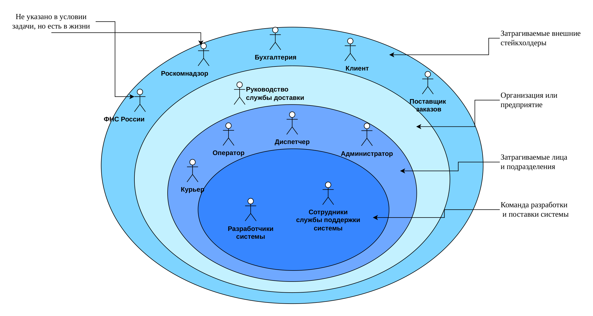

# 01 · Стейкхолдеры

*Проект Школы 21: BSA01 Stakeholders*

## Задача

Понять, кого затрагивает будущая система. Это не только пользователи, но и руководство, смежные отделы, регуляторы и команда разработки. Для каждого нужно выяснить интересы, потребности и проблемы: из них потом вырастают требования.

## Что сделано

**Доставка**
- Каталог из 12 стейкхолдеров с категорией и уровнем контакта с системой: от руководства службы и курьеров до ФНС и Роскомнадзора.
- Луковичная диаграмма: стейкхолдеры разложены по слоям, от команды разработки в центре до внешних сторон. Отдельно отмечены те, кого нет в условии задачи, но кто есть в жизни.
- Интересы, потребности и проблемы стейкхолдеров.
- Глоссарий пополнен до 15 терминов.

**Барбершоп**
- Интересы, потребности и проблемы 10 стейкхолдеров: руководитель сети, менеджер, мастер, зарегистрированный и незарегистрированный посетитель, бухгалтер, администратор, санэпиднадзор, служба сопровождения, команда разработки.
- Глоссарий пополнен до 15 терминов.

## Артефакты

| Артефакт | Доставка | Барбершоп |
|---|---|---|
| Каталог стейкхолдеров | [PDF](delivery/00-stakeholders.pdf) · [xlsx](delivery/source/00-stakeholders.xlsx) | — |
| Луковичная диаграмма | [PNG](delivery/01-onion-diagram.png) · [PDF](delivery/source/01-onion-diagram.pdf) | — |
| Интересы, потребности, проблемы | [PDF](delivery/02-needs.pdf) · [xlsx](delivery/source/02-needs.xlsx) | [PDF](barbershop/02-needs.pdf) · [xlsx](barbershop/source/02-needs.xlsx) |
| Глоссарий | [PDF](delivery/03-glossary.pdf) · [xlsx](delivery/source/03-glossary.xlsx) | [PDF](barbershop/03-glossary.pdf) · [xlsx](barbershop/source/03-glossary.xlsx) |

## Навыки

Выявление и классификация стейкхолдеров, луковичная диаграмма, анализ интересов, потребностей и проблем.
