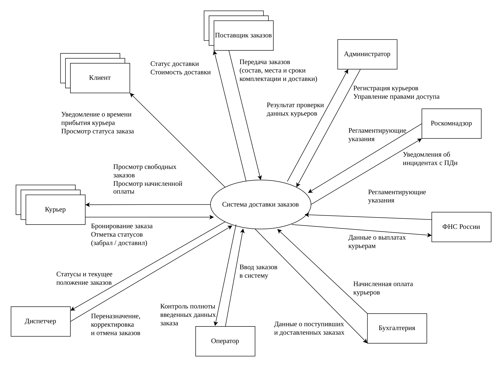

# 02 · Требования: as is → to be

*Проект Школы 21: BSA02 Requirements*

## Задача

Описать, как стейкхолдеры работают сейчас и что им мешает. Затем показать, как это будет устроено с системой и какое решение снимает каждую проблему. Отдельно определить границы системы: кто и какими данными с ней обменивается.

## Что сделано

**Доставка**
- As is: 34 действия по ролям, для каждого отмечен канал (телефон, мессенджер, очно) и проблема.
- To be: для каждого действия указано, где оно выполняется после внедрения и как решается проблема. Например, единая форма приёма заказа с обязательными полями вместо уточнений по телефону или отслеживание положения заказа в реальном времени вместо противоречивых сведений от курьера и клиента.
- Контекстная диаграмма: система и внешние участники с потоками данных между ними.
- Таблица входных и выходных потоков данных между системой и участниками.
- Глоссарий пополнен до 20 терминов.

**Барбершоп**
- As is: 36 действий по ролям с каналами и проблемами.
- To be: 38 действий с решениями.
- Таблица входных и выходных потоков данных между системой и участниками.
- Глоссарий пополнен до 20 терминов.

## Артефакты

| Артефакт | Доставка | Барбершоп |
|---|---|---|
| Роли и действия as is | [PDF](delivery/00-as-is.pdf) · [xlsx](delivery/source/00-as-is.xlsx) | [PDF](barbershop/00-as-is.pdf) · [xlsx](barbershop/source/00-as-is.xlsx) |
| Контекстная диаграмма | [PNG](delivery/01-context-diagram.png) · [PDF](delivery/source/01-context-diagram.pdf) | — |
| Роли и действия to be, решения проблем | [PDF](delivery/02-to-be.pdf) · [xlsx](delivery/source/02-to-be.xlsx) | [PDF](barbershop/02-to-be.pdf) · [xlsx](barbershop/source/02-to-be.xlsx) |
| Потоки данных | [PDF](delivery/03-data-flows.pdf) · [xlsx](delivery/source/03-data-flows.xlsx) | [PDF](barbershop/03-data-flows.pdf) · [xlsx](barbershop/source/03-data-flows.xlsx) |
| Глоссарий | [PDF](delivery/04-glossary.pdf) · [xlsx](delivery/source/04-glossary.xlsx) | [PDF](barbershop/04-glossary.pdf) · [xlsx](barbershop/source/04-glossary.xlsx) |

## Навыки

Анализ процессов as is и to be, поиск решений для проблем стейкхолдеров, контекстная диаграмма, проверка потоков данных.
