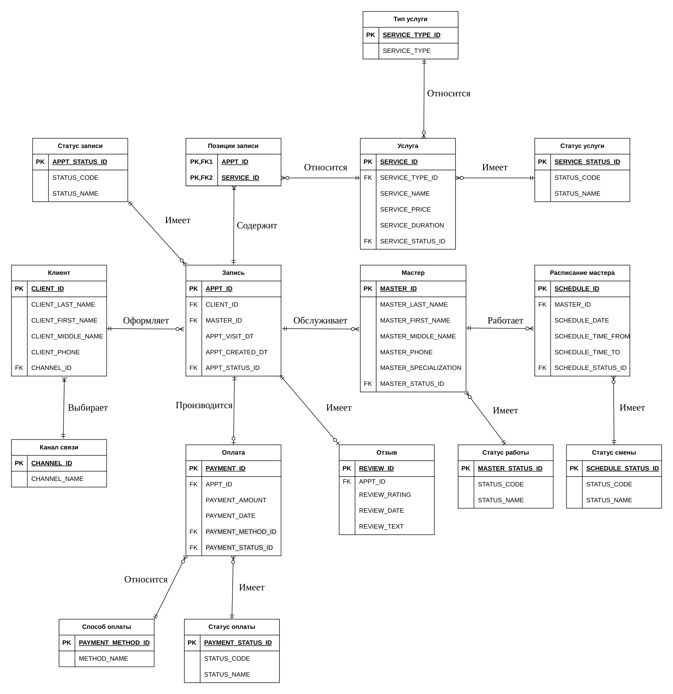

# 04 · Модель данных

*Проект Школы 21: BSA04 Domains*

## Задача

Описать предметную область через данные: какие сущности хранит система, какие у них атрибуты и как сущности связаны. Отдельно проверить, что у каждой сущности есть роли, которые её создают, читают, изменяют и удаляют.

## Что сделано

**Доставка**
- 7 сущностей с назначением и атрибутами: клиент, курьер, поставщик, пользователь, заказ, доставка, оплата.
- Словарь данных: 59 атрибутов с системными именами, типами и обязательностью.
- Логическая модель: 12 таблиц, включая справочники статусов, с ключами и связями.

**Барбершоп**
- 7 сущностей: клиент, мастер, расписание мастера, услуга, запись, оплата, отзыв.
- CRUD-матрица: какая роль создаёт, читает, изменяет и удаляет каждую сущность и что именно при этом делает.
- Словарь данных: 65 атрибутов.
- Логическая модель: 16 таблиц, включая справочники и связующую таблицу «Позиции записи» с составным ключом (одна запись — несколько услуг).

## Артефакты

| Артефакт | Доставка | Барбершоп |
|---|---|---|
| Сущности | [PDF](delivery/00-entities.pdf) · [xlsx](delivery/source/00-entities.xlsx) | [PDF](barbershop/00-entities.pdf) · [xlsx](barbershop/source/00-entities.xlsx) |
| CRUD-матрица | — | [PDF](barbershop/01-crud-matrix.pdf) · [xlsx](barbershop/source/01-crud-matrix.xlsx) |
| Словарь данных | [PDF](delivery/02-data-dictionary.pdf) · [xlsx](delivery/source/02-data-dictionary.xlsx) | [PDF](barbershop/02-data-dictionary.pdf) · [xlsx](barbershop/source/02-data-dictionary.xlsx) |
| Логическая модель | [PNG](delivery/03-logical-data-model.png) · [PDF](delivery/source/03-logical-data-model.pdf) | [PNG](barbershop/03-logical-data-model.png) · [PDF](barbershop/source/03-logical-data-model.pdf) |

## Навыки

Выявление сущностей и атрибутов, CRUD-анализ, словарь данных, логическая модель данных (ER).
