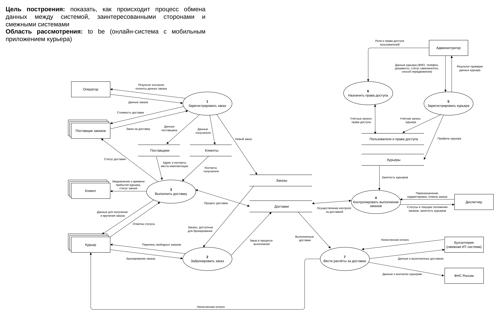

# 05 · Диаграммы

## Задача

Показать, как данные движутся между системой и участниками, кто какие шаги процесса выполняет и как меняется состояние ключевого объекта.

## Что сделано

Для обоих кейсов:
- **DFD уровня 0**: процессы системы, внешние участники, хранилища и потоки данных.
- **Swimlane-диаграмма** основного процесса To Be. В доставке это путь от передачи заказа поставщиком до вручения клиенту и начисления оплаты курьеру, в барбершопе — от записи на услугу до отзыва.
- **Расширенная swimlane-диаграмма**: добавлены документы и данные, которые возникают по ходу процесса.
- **Диаграмма и таблица состояний**: учётная запись курьера и смена мастера в расписании.

## Артефакты

| Артефакт | Доставка | Барбершоп |
|---|---|---|
| DFD уровня 0 | [PNG](delivery/00-dfd-level-0.png) · [PDF](delivery/source/00-dfd-level-0.pdf) | [PNG](barbershop/00-dfd-level-0.png) · [PDF](barbershop/source/00-dfd-level-0.pdf) |
| Swimlane | [PNG](delivery/01-swimlane.png) · [PDF](delivery/source/01-swimlane.pdf) | [PNG](barbershop/01-swimlane.png) · [PDF](barbershop/source/01-swimlane.pdf) |
| Swimlane с документами и данными | [PNG](delivery/02-swimlane-extended.png) · [PDF](delivery/source/02-swimlane-extended.pdf) | [PNG](barbershop/02-swimlane-extended.png) · [PDF](barbershop/source/02-swimlane-extended.pdf) |
| Диаграмма состояний | [PNG](delivery/03-state-diagram.png) · [PDF](delivery/source/03-state-diagram.pdf) | [PNG](barbershop/03-state-diagram.png) · [PDF](barbershop/source/03-state-diagram.pdf) |
| Таблица состояний | [PDF](delivery/04-state-table.pdf) · [xlsx](delivery/source/04-state-table.xlsx) | [PDF](barbershop/04-state-table.pdf) · [xlsx](barbershop/source/04-state-table.xlsx) |

## Навыки

DFD, swimlane-диаграммы, диаграммы и таблицы состояний.
